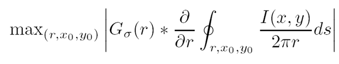
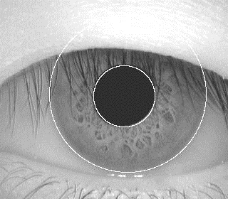
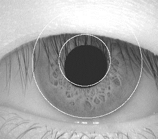
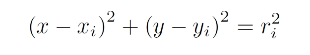
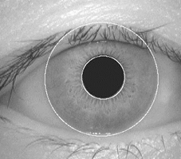
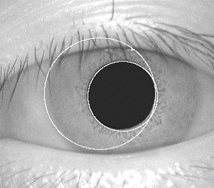
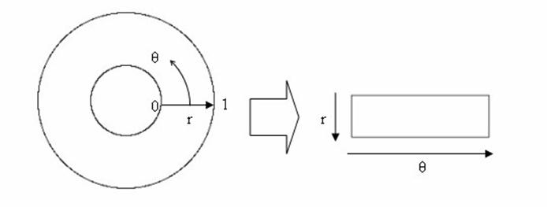
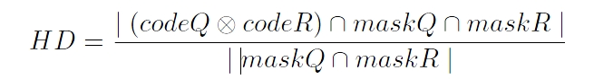

iris
====

Iris Recognition Algorithms Comparison between Daugman algorithm and Hough transform with Matlab.

> **Looking for a runnable version without MATLAB?** A Rust port of the Daugman branch lives at **[Qingbao/iris-rust](https://github.com/Qingbao/iris-rust)**. Same algorithm, same EER ballpark on CASIA v1.0 (0.0172 vs the 0.0157 here), single static binary, end-to-end run in ~2 minutes instead of hours. See the comparison below to decide which repo to use.

### Which repo should I use?

| | This repo (MATLAB) | [iris-rust](https://github.com/Qingbao/iris-rust) |
|---|---|---|
| Algorithms | Daugman **and** Hough (side-by-side comparison) | Daugman only |
| Runtime | MATLAB license required | Single static binary, no runtime deps |
| Enroll 756 images | ~30–60 min | ~13 s |
| Match 283 122 pairs | hours | ~90 s |
| EER on CASIA v1.0 | 0.0157 (Daugman), 0.0500 (Hough) | 0.0172 (Daugman) |
| Best for | Reading the algorithms side-by-side, reproducing the original paper's comparison, teaching | Running the recognition pipeline, batch processing, integration into other software |

Pick **this repo** if you want to study or compare the two segmentation approaches in MATLAB, or if you specifically need the Hough variant. Pick **iris-rust** if you just want to run iris recognition on CASIA images.

### DESCRIPTION:
Iris is one of the most important biometric approaches that can perform high confidence recognition.
Iris contains rich and random Information.
Most of commercial iris recognition systems are using the Daugman algorithm. The algorithms used in this project are from open source with slightly modifications, if you would like to use the source code, please check the LICENSE first!

### Daugman algorithm:

where I(x,y) is the eye image, r is the radius to search
over the image (x,y), G(r) is a Gaussian smoothing function. The algorithm starts to search from the pupil, in order to detect the changes of maximum pixel values (partial derivative).

### Hough transform:

The Hough transform is a feature extraction technique used in image analysis, computer vision, and digital image processing.
where (xi, yi) are the central coordinates, and r is the radius. Generally, and eye would be modeled by two circles of pupil and limbus (iris region), and two parabolas of upper and lower eyelids

It starts to detect the eyelids form the horizontal direction, then detects the pupil and iris boundary from the vertical direction.

### NORMALIZATION AND FEATURE ENCODING:
From circles to oblong block By using the 1D Log-Gabor filter.
In order to extract 9600 bits iris code, the upper and lower eyelids will be processed into a 9600 bits encoded mask.

### MATCHING:
Hamming distance (HD):

Q and R are the subjects to compare, that contain 20x480=9600 template bits and 20x480=9600 mask bits, the calculation is using XOR and AND boolean operators.

### Results:
CASIA Iris Image Database(version 1.0) (http://biometrics.idealtest.org/dbDetailForUser.do?id=1): 756 iris images form 108 different subjects. High quality of images by using NIR camera.

Resolution of 320*280.

Totally, 756*755/2=285390 pairs of comparison for each algorithm, 2268 for intra-class comparison and 283 122 for inter-class comparison.

### EER:
Daugman algorithm: 0.0157    Hough transform: 0.0500

How to run the program
====

1. Download the CASIA Iris Image Database(version 1.0) from (http://biometrics.idealtest.org/dbDetailForUser.do?id=1) (Sign-up required)

2. Read all images and extract features using the read_all_images.m and createiristemplate.m. (Templates created)

3. The templates of each subject will be saved into template.mat and mask.m after you creating the templates. Using matching.m to calculate the Hamming distance (HD) for the same subject(intra-class) and different subjects (innner-class) and saving the results into HD_diff.mat(different subjects) and HD_same.m (same subject), then you can calculate the EER which is the final performance for each algorithm by using EER_*.m.

